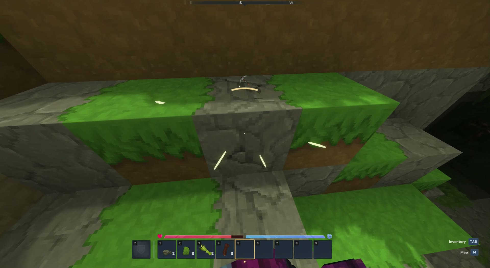

# Sound Compass

Icon-only directional sound indicators for deaf and hard-of-hearing Hytale players, inspired by Fortnite's visual sound cues.

**This project was made by AI.** OpenAI Codex generated the mod code, tests, build scripts and documentation under Waryck's direction. Waryck provided the accessibility goals, design feedback, in-game testing and showcase recording. The icons are existing Hytale game assets copied locally during the build.

**Prototype 0.2.0 · Hytale 0.7.2 · Singleplayer first**

## Showcase

https://github.com/user-attachments/assets/fe252845-fab7-4f48-9c6c-6f6a589cd747



Recorded by Waryck during singleplayer testing. [Download the showcase recording](docs/showcase.mp4).

## Features

- Eight sound directions around the crosshair, following the player's head rotation.
- Icons and short ring segments, without words or text panels.
- A shared sword icon for weapon attacks, including daggers, maces and battleaxes.
- An axe for wood and stick hits/breaks; a pickaxe for stone and ore hits/breaks.
- Boots for identifiable running/sprinting; footprints for ordinary walking.
- A separate icon below the crosshair when a sound has no known direction.
- Personal enable/disable, two icon sizes, quiet mode and saved preferences.
- Brief indicators, merged repeats and priority for combat when sounds overlap.
- A separate named HUD layer that preserves other mods' overlays.

## Install in singleplayer

1. Build the mod as described below.
2. Save and return to Hytale's main menu.
3. Place `dist/SoundCompass-0.2.0.jar` in `UserData/Saves/<your world>/mods/`. Remove older Sound Compass JARs from that folder.
4. Enable **Deaftale:SoundCompass** in that world's mod settings, then reopen the world.
5. Run `/sc demo` to preview the icons without playing any audio.

Singleplayer runs a local server internally, which loads this mod. A dedicated server is not required. The Hytale version must match the version declared in `src/main/resources/manifest.json`.

| Command | Effect |
| --- | --- |
| `/sc` | Help and current enabled state |
| `/sc on`, `/sc off` | Enable or disable your indicators |
| `/sc small`, `/sc large` | Standard or larger icons |
| `/sc quiet` | Combat, creature and footstep categories only |
| `/sc all` | Also include harvesting, interactions, environment and other sounds |
| `/sc demo` | Six-second visual demonstration, with no audio |

`/soundcompass` is an alias for `/sc`. Commands affect only the player using them and do not require operator permissions. Preferences are saved as `players.properties` in the mod's data folder.

The demo shows footprints ahead, an axe ahead-right, a sword to the right, a pickaxe behind-right, a goblin behind and sprinting boots behind-left. Chat announces the demo; the overlay stays icon-only.

If `/sc` is unknown, check that the mod is enabled for that world and that the game version matches, then restart the world.

## Sound icons

| Sound | Icon |
| --- | --- |
| Weapon attack | Iron sword, shared across weapon types |
| Wood/stick hits or breaks; hatchet sounds | Iron hatchet |
| Rock/ore hits or breaks; pickaxe sounds | Iron pickaxe |
| Walking | Footprint |
| Identifiable running/sprinting | Boots |
| Identifiable goblin sound | Goblin breach compass icon |
| Other creature sound | Animal track |
| Other interaction | Home marker |
| Environment | Campfire marker |
| Unknown sound | Generic marker |

Weapon axes and stone/wooden weapons stay in the sword category. Walking on wood or stone does not trigger harvesting icons. Opening a wooden chest stays a general interaction.

Icon mapping and source asset paths are in `tools/generate_resources.py`. Hytale artwork and server binaries are **not included in this repository**. The local build copies ten icons from your own installed `Assets.zip` into the generated custom UI folder. This avoids the client UI loader's restrictions on parent-directory texture paths. Copied icon hashes and source paths are recorded in the generated `icon-sources.json`.

## Build

Requirements:

- Java 25 JDK
- Python 3
- A local Hytale 0.7.2 installation, including `Server/HytaleServer.jar` and `Assets.zip`
- Bash on Linux

The script detects the default Linux Flatpak game folder. For another installation, set these paths:

```bash
export HYTALE_SERVER_JAR="/path/to/Hytale/Server/HytaleServer.jar"
export HYTALE_ASSETS="/path/to/Hytale/Assets.zip"
export SOUND_COMPASS_JDK="/path/to/jdk-25"
./build.sh
```

`JAVA_HOME` or a JDK on `PATH` can also select the compiler. Alternatively, `HYTALE_GAME_DIR` can point to the game folder containing `Server/` and `Assets.zip`.

The build generates UI files, ring segments and local icon copies, compiles the plugin, runs its checks and creates `dist/SoundCompass-0.2.0.jar`. Generated resources and compiled builds are ignored by Git.

## Verification

The current build passes **119 automated checks** covering bearings, camera rotation, expiry, range filtering, self-footstep suppression, sound prioritization, bounded floods, weapon/harvesting/sprinting mappings and preference persistence.

Package checks validate both UI layouts' 36 texture references, reject parent-directory texture paths and text labels, and verify all ten native icon copies by hash. Plugin loading, command registration and clean shutdown were checked against Hytale 0.7.2 in an isolated local test. The showcase documents singleplayer testing; it does not establish complete sound coverage.

## Current limitations

This prototype watches outgoing `PlaySoundEvent3D`, `PlaySoundEventEntity`, `PlaySoundEvent2D` and `PlaySoundEventLocalPlayer` messages. It does not cancel or modify those messages.

**Some sounds are still missing.** Client-generated footsteps, animation sounds, interaction sounds or ambient audio may never produce one of those messages. Voice transcription is not included. Looping sounds currently produce a brief cue instead of a continuously tracked indicator.

For entity-attached footsteps, running/sprinting state selects boots even when the surface sound is shared with walking. Explicit run/sprint sound names also select boots. Position-only shared sounds without an identified actor retain the footprint icon. Movement state alone does not generate a cue.

Received sounds are filtered by the sound asset's maximum distance and a 48-block cap. Final client volume, attenuation, occlusion and mixing are not available to this implementation. It does not discover silent enemies from proximity alone. Classification uses sound identifiers and can be imperfect.

Indicators last 1.8 seconds. Each player has at most 64 active cues and 128 pending messages. Updates run at most ten times per second; entity reads occur on the owning world thread. Custom camera modes and different screen/UI scaling settings need further testing.

## Contributing

For missing or incorrect indicators, open an issue with the Hytale version, the action or creature involved, expected icon, and a short recording if available. Include the relevant client/server error for loading failures, with private information removed. Changes to sound mapping should add a case in `CueEngineTest.java`.

This is an independent Hytale community project.
